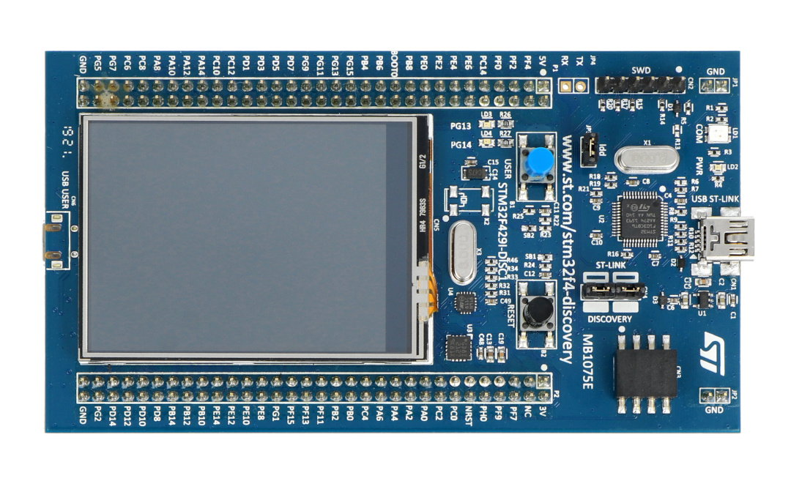
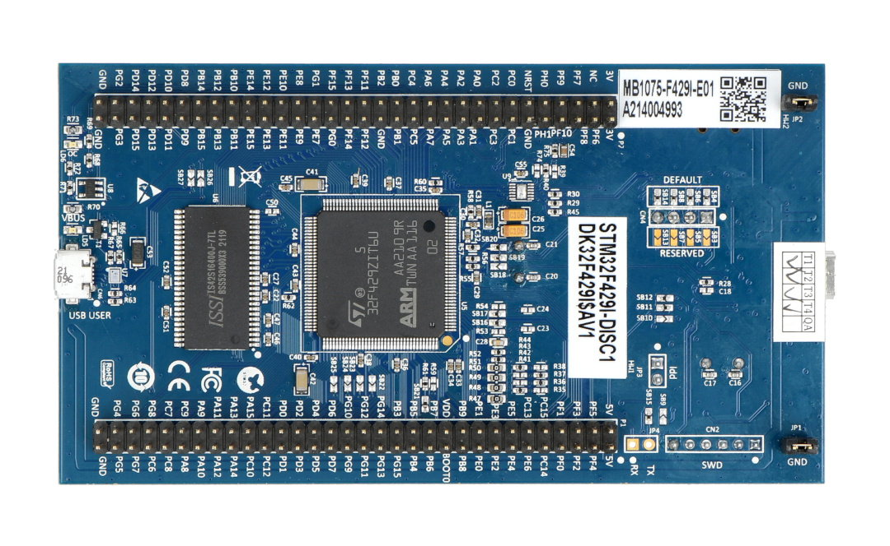

# STM32F429I-DISC1 reference photographs

Full native-resolution product images from [Botland’s STM32F429I-DISC1 listing](https://botland.store/stm32-discovery/1940-stm32f429i-disc1-discovery-stm32f429idiscovery-24-screen-5904422330422.html), retrieved 2026-11-05. Image credit: Botland product gallery; depicted board manufactured by STMicroelectronics. These are external reference photographs, separate from the five user-supplied component photographs in the parent directory.

The blue board is marked MB1075E on the LCD side and MB1075-F429I-E01 on the back. The user confirmed DISC1, but their PCB revision has not been established. Use these images for orientation; confirm the actual board revision and matching ST schematic before wiring.

Source bytes are preserved without resizing, upscaling or alteration. Native dimensions and SHA-256 hashes follow.

## Front / LCD side

- File: `stm32f429i-disc1-front-mb1075e.jpg`
- Native resolution: 1080 × 657 pixels.
- [Original source image](https://cdn2.botland.store/114754/stm32f429i-disc1-discovery-stm32f429idiscovery-24-screen.jpg)
- SHA-256: `fa6e992e21903db3dcc62025595702cffc90ea96a32205c07e2aa500c8f583ca`

## Back / MCU and SDRAM side

- File: `stm32f429i-disc1-back-mb1075e01.jpg`
- Native resolution: 1080 × 664 pixels.
- [Original source image](https://cdn2.botland.store/114755/stm32f429i-disc1-discovery-stm32f429idiscovery-24-screen.jpg)
- SHA-256: `f3ba3831684cbcb2b64bf5a6ddcba61b207f550eb863aca8f92cbeda8a6bc132`
